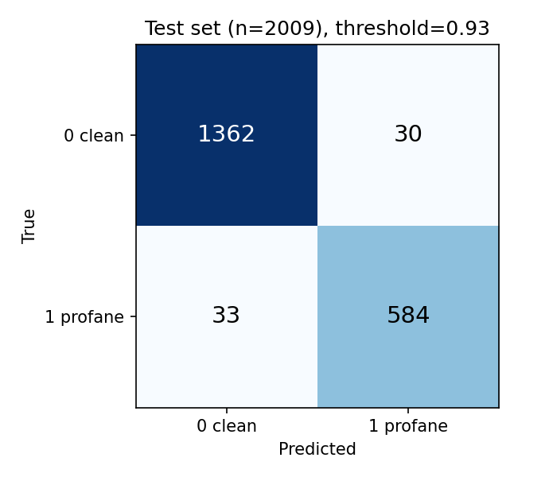

# Kazakh Profanity Detection in Product Reviews

**DSSC5113 – Bonus Project** · Author: Bektemissov Nurdaulet · Student ID: 25MD0461

A fine-tuned **XLM-RoBERTa-base** model that reads one Kazakh review/comment about a product or app
and predicts:

| label | meaning |
|---|---|
| `0` | no Kazakh profanity |
| `1` | Kazakh profanity present (obscene words **or** insults, see the labeling rules) |

It also outputs the probability `p(profane)`, so you can see how confident the prediction is.

---

## Quick start

**Option A – Google Colab (recommended, GPU):** open
[`notebooks/Kazakh_Profanity_Colab.ipynb`](notebooks/Kazakh_Profanity_Colab.ipynb) in Colab,
choose *Runtime → T4 GPU*, and run the cells top to bottom (data → 3 training runs (ablation) → evaluation → prediction).
Section 7 of the notebook loads the trained model and predicts **without retraining**.

**Option B – local (Python 3.10+):**

```bash
git clone https://github.com/⟨USERNAME⟩/kazakh-profanity-detection.git
cd kazakh-profanity-detection
pip install -r requirements.txt

python src/prepare_data.py     # 1. build labeled train/val/test (seed 42)
python src/train.py --normalize 0 --augment 0 --output_dir model/xlmr-raw --results_dir results/ablation_raw    # 2a. ablation
python src/train.py --normalize 1 --augment 0 --output_dir model/xlmr-norm --results_dir results/ablation_norm  # 2b. ablation
python src/train.py            # 2c. full pipeline (normalized + augmentation)
python src/compare_ablation.py # 2d. compare all runs + the word-list baseline on the VALIDATION set
python src/evaluate.py         # 3. one evaluation of the chosen model on the test set -> results/
python src/predict.py "Тауар сапалы екен, рахмет!"     # 4. predict on new text
python src/predict.py          # interactive mode: type comments, empty line = quit
```

### Model download (no retraining needed)
The trained model (~560 MB, fp16) is stored on Google Drive: **<https://drive.google.com/file/d/1EqR_hjzd5Kzskw9xVtzB8h4W0qtIQwDa/view?usp=sharing>** (XLM-R + normalization, the chosen model)

```bash
pip install gdown
gdown 1EqR_hjzd5Kzskw9xVtzB8h4W0qtIQwDa -O model.zip && unzip model.zip -d model
python src/predict.py "Мына ойын керемет екен"
```
The folder `model/xlmr-kaz-profanity/` contains everything needed for inference:
`model.safetensors`, `config.json`, `tokenizer.json`, `tokenizer_config.json`, and
`inference_config.json` (decision threshold, max length, window stride, normalization on/off).

In Python:
```python
import sys; sys.path.insert(0, "src")
from predict import ProfanityDetector
det = ProfanityDetector("model/xlmr-kaz-profanity")
det.predict(["Өте нашар қызмет", "Qotaqbas oyin"])
# [{'text': 'Өте нашар қызмет', 'label': 0, 'probability_profane': 0.01, ...}, ...]
```

---

## 1. Dataset

### Sources and access
1. **KazSAnDRA**, the *Kazakh Sentiment Analysis Dataset of Reviews and Attitudes*
   (Yeshpanov & Varol, LREC-COLING 2024, ISSAI, Nazarbayev University; license **CC BY 4.0**;
   <https://github.com/IS2AI/KazSAnDRA>).
   It has **167,961 real Kazakh reviews** with 1–5 star ratings from app store reviews (apps and games),
   **online marketplace product reviews**, maps/places, and an online bookstore. This is the target genre:
   informal Kazakh reviews of goods and services, often mixed with Russian, in Cyrillic or Latin script.
   The three *polarity* files (`01_pc_train_ib`, `04_pc_valid`, `05_pc_test`, together = all reviews) are in
   `data/raw/` (8 MB) with attribution.
2. **A classmate's labels** ([`data/peer/peer_labels.csv`](data/peer/peer_labels.csv)) for 3,061 KazSAnDRA
   reviews (ID + 0/1 label). The texts come from KazSAnDRA itself, so this file adds **a second annotator**
   rather than new reviews (see "Second annotator" below).

### Why the KazSAnDRA labels could not be used
KazSAnDRA labels **sentiment**, not profanity:
- **44%** of our 4,115 profane reviews have a **positive** rating (e.g. "Күшті екен ебатть" = *"Damn, it's great"*);
- most negative reviews contain no profanity ("Неге менде сеть ұстамайды" = "Why is there no network signal on my phone").

So **a negative review is not automatically profane**, and we made our own binary labels.

### Labeling rules
A review is **1 (profane)** if it contains at least one of the following:

1. **Kazakh obscene words** and their forms: *қотақ, қотақбас, ам / амы / амшық, сігу (сігейін, сігем…),
   шешеңнің амы, жалап, қаншық, ташақ*, and the abbreviations **шшс / щщс / шщс / 667** (= "шешеңді сігейін")
   and **зб** (= "заебал"). **бл** (= "бля") counts too, but it is also short for *бұл* ("this"), e.g. "Бл кітап өте
   қызықты", so every "бл" was checked by hand.
2. **Vulgar body/excrement words used as swearing**: *көт* ("көтіңді қыс", "көт ойын"), *боқ* ("боқ ойын").
3. **Russian mat inside a Kazakh review** (mixed-language rule): *бля, нахуй, пиздец, заебал/зайбал,
   долбаёб/далбайоп, сука, гандон, пидор, говно/гавно…*. Code-switching is normal in Kazakhstan, and a
   moderator of Kazakh reviews has to remove these words too.
4. **Insults** directed at people or at the product: *мал, малдар, малски, есек/ешак, ақымақ, топас, лох,
   тупой, дебил, жынды, чорт, шошқа, далбан*, and *ит / қатын* when used as insults.
   We include them following the shared class (classmate) definition: for moderation, "мал екенсіңдер" is as
   unwanted as a swear word.
5. **Spelling variants count**: Cyrillic with or without Kazakh letters (*қотақ / котак*), Latin (*kotak, qotaq,
   zaibal, Mal eken*), the 2021 Kazakh Latin alphabet (*shesheńdi*), stretched letters (*бляяя*), glued words (*шешеңамыссігейн*).
6. **Masked words count** if the hidden word is still clear: *бл\*\*, с@ки, қо#\*қ, с\*\*ейін, м\*л*.

A review is **0 (clean)** if it has none of these, even if it is:
- **negative or angry** ("Өте жаман ойын", "Неге менде сеть ұстамайды");
- **talking about swearing** ("Боқтау көп" = "there is a lot of swearing");
- **using an insult word literally or in an idiom**: *мал базары* (livestock market), *мал шаруашылығы*,
  *поп ит* (toy), *ит көзімен* (idiom), *адамды ақымақ қылу* (to make a fool of someone), *ақымақтық* (foolishness, abstract);
- **a look-alike word**: *сигнал*, *шешеді* (solves), *Шешенстан* (Chechnya), *Toca Boca*, *амин* (amen), *көтеру* (to lift),
  *кот* (Russian "cat"), *Хернандес* (a footballer), *коттакон* (Uzbek "big");
- **a neutral body word in a product review**: diaper review "баланың көтені құрғақ";
- *далбаса* ("useless thing") describing an app: we treat it as rude but not an insult.

**Ambiguous cases** (gibberish, possible typos, nicknames like "Көтенбай") were **excluded**: 114 reviews.

### Labeling method
1. A word-stem lexicon ([`src/lexicon.py`](src/lexicon.py)) runs on **normalized** text (Latin → Cyrillic, see §2)
   and finds candidates in all 167,961 reviews. It is only a labeling tool; the trained model does not use it.
2. **Clearly obscene** stems → 1 automatically. **Masked** words are un-masked against the vocabulary of profane
   words found in the corpus (`бл**` matches `бля…`).
3. **Insults** in app-store reviews → 1 automatically. Words with a common literal meaning (*ит, қатын*) and **all insult
   words in marketplace / maps / bookstore reviews** were **read and labeled by hand** (154 reviews).
4. Context-dependent vulgar words (*көт, боқ, ам, қаншық*): all 241 matches were labeled by hand. Rare word forms (282 reviews)
   were checked by hand, and false positives were fixed (*сыққанда* "when squeezing", *сигені* "its pee" in a diaper review).
5. All hand decisions are in [`data/manual_labels.csv`](data/manual_labels.csv) (542 rows: 333 → 1, 125 → 0, 84 excluded).
   They override the lexicon.

### Second annotator (classmate's labels)
On the **2,886** reviews that both of us labeled, the **first pass** (lexicon + my hand labels, before looking at
his disagreements) gave:

| | classmate 0 | classmate 1 |
|---|---:|---:|
| **me 0** | 1,394 | 104 |
| **me 1** | 30 | 1,358 |

**Agreement 95.4%, Cohen's κ = 0.91** (almost perfect agreement) — [`data/peer/agreement_first_pass.json`](data/peer/agreement_first_pass.json).
Before aligning the definitions (when insults were still 0 for me) κ was only 0.46, so the main difference was the
*definition*, not careless labeling.

Then I **adjudicated** all 134 disagreements by hand (`note = "v2 adjudicated"` in `manual_labels.csv`):
- his label adopted in most cases: he found masked forms (*бл\*\*, с\*ка*), Latin forms (*Qotagimdi, Mal eken*), *шшс*, and
  *шешең* used alone as a curse; these also improved the lexicon;
- he also explained the number slang **667** = *шшс* (шешеңді сігейін), which we added as a rule;
- my label kept where he missed a word (*"Қотақ амсын была"*) or where the word was literal (*Шешенстан, Among Us*).

**How his data was merged:** every review he labeled is **included** in our dataset (2,870 after duplicates/exclusions),
with labels following our rules + the adjudication. We did **not** use his train/val/test split: 111 of his test
reviews were in our training set, which would leak test data. All data was re-split together with our grouping.

### Building the final dataset
Profanity is rare (≈2.5% of all reviews), so we keep **all profane reviews**, **all classmate-labeled reviews**, and a
sample of clean reviews (seed 42): about 0.8 *negative-rating* + 0.8 *random* + 0.3 *look-alike word* clean reviews per
profane review, plus all *insult-word-used-literally* reviews. The `source` column tells which group a row came from.

| | total (real reviews) | profane (1) | clean (0) |
|---|---:|---:|---:|
| **train** | 9,382 | 2,881 | 6,501 |
| **validation** | 2,010 | 617 | 1,393 |
| **test** | 2,009 | 617 | 1,392 |
| **all** | **13,401** | **4,115** | **9,286** |
| *train_augmented (synthetic, train only)* | *1,200* | *600* | *600* |

### Categories (for analysis; the label stays binary)
Each row has two extra columns, used to analyse errors (recall per category in `results/test_metrics.json`):

| `profanity_type` (real profane reviews) | count | | `script` (real profane reviews) | count |
|---|---:|---|---|---:|
| insult only | 1,416 | | Cyrillic **with** Kazakh letters | 2,760 |
| Kazakh obscene only | 1,306 | | Cyrillic **without** Kazakh letters | 1,289 |
| Russian obscene only | 910 | | Latin | 66 |
| mixed Kazakh + Russian obscene | 353 | | | |
| masked only | 56 | | | |
| other (hand-labeled, e.g. *шешең*) | 74 | | | |

We did **not** turn these into separate classes: the task asks for a binary label, and small groups (e.g. 40 Latin
reviews in the test set) would be too small to learn and to evaluate.

### Splits, duplicates, seed
- **Exact duplicates removed** (same text after normalization, lower-casing, keeping letters only, collapsing repeats).
- **Near-duplicates grouped** (same set of words, or same normalized text). The split is done **by group**, so near-duplicates
  are always in the same split (checked with an `assert`).
- **70 / 15 / 15**, stratified by label, **random seed 42**. Details: [`data/processed/split_info.json`](data/processed/split_info.json).
- `prepare_data.py` is deterministic: re-running it gives byte-identical CSV files.

### Data augmentation (synthetic, clearly marked, train only)
People hide or change profane words, but such real examples are rare (e.g. symbols instead of letters like *&otaq* or
*к0тақ* almost never appear in KazSAnDRA). So [`src/augment.py`](src/augment.py) creates **1,200 synthetic copies of
training reviews** in a separate file, `data/processed/train_augmented.csv` (`is_synthetic = 1`, `source = synthetic_<type>`):

| type | example (profane) | example (clean) |
|---|---|---|
| `mask` | *қотақбас → қотақб\*\*с* | *керемет → кер\*мет* |
| `symbols` | *далбаёб → д4лб4ёб*, *нахуй → наху1* | *жақсы → жақ$ы* |
| `latin` | *"Мал ойын" → "mal oiyn"* | *"Өте жақсы" → "ote zhaqsy"* |
| `no_kazakh` (no Kazakh keyboard) | *қотақ → котак* | *ұнады → унады* |

Each type is applied to **150 profane + 150 clean** reviews, so a symbol or Latin text alone does not mean "profane".
Labels never change. Augmented rows are used only with `--augment 1` (training); validation and test contain **only real reviews**.

### Personal information
KazSAnDRA has no reviewer names or contact data. Inside review texts we replaced phone/ID numbers → `<NUMBER>`,
e-mails → `<EMAIL>`, links → `<URL>`, @handles → `<USER>`, and surnames → `<NAME>`.

### Labeled examples

| review (real, from the dataset) | label | type / why |
|---|:-:|---|
| қотағым жеген ойын | 1 | Kazakh obscene |
| Күшті екен ебатть | 1 | Russian mat in Kazakh text; positive review but profane |
| Вы заебали уже одобрения бермей наххуй | 1 | mixed Kazakh–Russian |
| Qotagimdi je | 1 | Latin script |
| Ой бл\*\* | 1 | masked |
| Малдар парковкада 10 минуттан артык турмандар | 1 | insult |
| Форте банк. Банктардың ішіндегі ең топас, ең сорлы банк | 1 | insult (*топас*) |
| Неге менде сеть ұстамайды соны білгім келед | 0 | negative, no profanity |
| Уау маған осы иттің ойын да мышықтың ойыныда ұнады | 0 | *ит* = dog (literal) |
| Жұқа, баланын көтені демалады... | 0 | neutral word in a diaper review |
| Боқтау көп | 0 | talks about swearing ("there is a lot of swearing") |
| Достарыммен Несиелер. Шешенстанда | 0 | look-alike (*Шешенстан* = Chechnya) |

---

## 2. Model

### Choice: XLM-RoBERTa-base (fine-tuned)
- `FacebookAI/xlm-roberta-base` is a Transformer encoder (12 layers, 278M parameters) **pretrained on 2.5 TB of text in
  100 languages, including Kazakh and Russian**. Our reviews mix exactly these two languages.
- *Why not a Kazakh-only model?* Kazakh-only models (e.g. Kaz-RoBERTa) know Russian less well, but 960 of our profane
  reviews contain only Russian mat. The other 98 languages in XLM-R don't hurt; they are simply not used.
- We **fine-tune** all layers plus a new classification head (2 outputs).
- *Why not just the lexicon?* A word list cannot use context (*мал базары* vs *мал екенсің*, diaper *көтені*) and misses new
  spellings. The fine-tuned model learns from examples.

### From text to model input
1. **Cleaning + normalization** (`clean_text` → [`src/normalize.py`](src/normalize.py)):
   - Latin-script reviews → **Kazakh Cyrillic** (informal *sh, zh, ch, q, w=ш, y=ы* and the 2021 alphabet *á ǵ ı ń ó ú ý*):
     *"Qotaqbas oyin" → "Қотақбас ойин"*, *"Mal eken" → "Мал екен"*. This is done only if the review is mostly Latin
     or the word uses Kazakh-Latin letters, so English brand names in Cyrillic reviews (*Free Fire*) stay unchanged;
   - Latin look-alike letters inside Cyrillic words → Cyrillic (*кoтак* with a Latin *o* → *котак*);
   - symbols used as letters inside a word → letters (*к0тақ* → *котақ*: 0→о, @→а, $→с, 3→з);
   - 3+ repeated letters → 2 (*бляяяяя* → *бляя*);
   - **we do NOT remove Kazakh letters** (қ→к, ө→о): *көт* ("ass") would become *кот* ("cat");
   - case, punctuation, emoji and `*` are kept (XLM-R was pretrained on raw text).
2. The **SentencePiece tokenizer** (250k sub-words) splits text into pieces. A rare word like *қотақбастар* becomes several
   pieces, so there are almost **no unknown words**: misspellings and glued words become known pieces.
3. `<s> … </s>` are added → ids + attention mask → 12 layers → the `<s>` vector → classification head → 2 logits →
   softmax → `p(profane)`.
4. **Decision:** `label = 1` if `p(profane) ≥ threshold` (the threshold is chosen on validation).

### Long comments
95% of reviews are shorter than ~230 characters, so `max_length = 128` tokens covers almost all of them. In training,
longer texts are truncated. In validation, test and prediction, long texts are split into **overlapping 128-token windows**
(overlap 32). The text gets the **maximum** probability over its windows, so a swear word at the end is not lost.

### Ideas from the course lectures (DSSC5113)
| lecture | idea | how it is used here |
|---|---|---|
| Week 2 – backpropagation | gradients through the network | all 12 layers are fine-tuned end-to-end; gradient clipping at 1.0 |
| Week 3 – normalization, losses, optimizers | input normalization | text normalization (Latin→Cyrillic, look-alikes, symbols, repeats): equal words get equal input |
| | loss functions | **class-weighted cross-entropy**: w_c = N / (2·N_c) → profane ≈1.5, clean ≈0.75 |
| | optimizers | AdamW + linear warm-up/decay |
| Week 4 – generalization | train / val / test is part of the method | settings, epoch, threshold and temperature chosen on validation; test used once |
| | "L2 inside Adam is not AdamW" | decoupled weight decay (AdamW, 0.01) |
| | dropout | XLM-R's built-in dropout (0.1) is active in training, off in `eval()` |
| | "augmentation is an invariance claim" | augmentations keep the label (a masked swear word is still a swear word) and are applied equally to both classes |
| | "one change, one interpretable comparison" | ablation adds one step at a time: raw → + normalization → + augmentation |
| | learning curves / early stopping | the epoch with the best validation F1 is kept |
| Week 5 – evaluation and reliability | leakage and shortcuts | near-duplicate grouping; classmate's split not reused (111 test reviews were in our train set) |
| | confusion matrix, thresholded decisions | threshold tuned on validation; FP/FN discussed for moderation |
| | calibration (ECE, temperature scaling) | temperature *T* fitted on validation; ECE before/after on test |
| | a metric also has uncertainty | 95% bootstrap confidence intervals for precision, recall, F1 |
| | abstention | unsure reviews (0.2 < p < 0.8) can go to a human; coverage and F1 of the automatic part reported |
| | distribution shift | robustness test with rewritten reviews; domain imbalance in limitations |
| Week 6 – transfer learning | pretrained backbone + new head | XLM-R pretrained weights + new 2-class head, fine-tuned |
| Week 9 – sequence models | order and context matter | (an LSTM could be a baseline; we use attention instead) |
| Week 10 – Transformers | tokenization, self-attention, context ("which crane?") | sub-word tokenizer; attention uses context: *мал базары* (0) vs *мал екенсің* (1) |

### Training settings ([`config.json`](config.json))
| setting | value |
|---|---|
| objective | class-weighted cross-entropy over 2 classes |
| optimizer | AdamW, lr 2e-5, weight decay 0.01, gradient clipping 1.0 |
| schedule | linear warm-up (10% of steps) then linear decay |
| batch size / epochs | 16 / 4 |
| max length / window stride | 128 / 32 tokens |
| text normalization / augmentation | both compared in the ablation; the final model uses normalization only |
| mixed precision | fp16 on GPU |
| seed | 42 (Python, NumPy, PyTorch, data shuffling) |
| model selection | the epoch with the best validation F1 (profane class) |
| calibration | temperature scaling, *T* fitted on validation (NLL) → **T = 2.0** |
| threshold | grid 0.05–0.95 on calibrated probabilities, best validation F1 → **0.93** |
| chosen run | normalization on, augmentation off (best validation F1), best epoch 4 |
| hardware / time | Google Colab, Tesla T4, ~9.5 minutes per training run |
| software | Python 3.13.16, torch 2.14.1+cu130, transformers 5.23.0 (saved in `results/*/training_log.json`) |

---

## 3. Results

### With and without each step of the pipeline (validation set)
From [`results/ablation.md`](results/ablation.md) (validation: 2,010 reviews, 617 profane):

| setting | best epoch | threshold | val precision | val recall | **val F1** |
|---|---:|---:|---:|---:|---:|
| word list only (no model) | – | – | 0.9915 | 0.9400 | 0.9651 |
| XLM-R, raw text | 4 | 0.95 | 0.9659 | 0.9190 | 0.9419 |
| XLM-R, + normalization | 4 | 0.93 | 0.9608 | **0.9530** | **0.9569** |
| XLM-R, + normalization + augmentation | 3 | 0.92 | 0.9557 | 0.9449 | 0.9503 |

- **Normalization helps:** +1.5 F1 points, mostly through recall (0.919 → 0.953). The model now also catches Latin and
  look-alike spellings.
- **Augmentation did not help on validation** (−0.7 points). This is expected: real validation reviews contain almost no
  masked or symbol-substituted words, so the benefit of augmentation cannot show there (see the robustness test below).
- **Chosen model: XLM-R + normalization** (best validation F1). Only this model was evaluated on the test set.
  Its training log is [`results/ablation_norm/training_log.json`](results/ablation_norm/training_log.json); to retrain it:
  `python src/train.py --normalize 1 --augment 0`.
- *Word-list baseline:* our labels were created with the help of this word list, so on our own data it is **unfairly
  strong** (it partly "grades its own homework"). It fails on spellings it was not written for (robustness test).

### Test set (evaluated once)
From [`results/test_metrics.json`](results/test_metrics.json):

| metric (profane class = 1) | value | 95% bootstrap CI |
|---|---:|---|
| test examples | 2,009 (617 profane, 1,392 clean) | |
| precision | **0.951** | 0.934 – 0.967 |
| recall | **0.947** | 0.926 – 0.963 |
| **F1** | **0.949** | 0.935 – 0.961 |
| accuracy | 0.969 | |



TN = 1,362 · **FP = 30** · **FN = 33** · TP = 584. So 30 clean reviews were wrongly flagged and 33 profane reviews were missed.

**Recall by category** (how many profane reviews of each kind were caught):

| profanity type | n | recall | | script | n | recall |
|---|---:|---:|---|---|---:|---:|
| Kazakh obscene | 193 | 0.964 | | Cyrillic with Kazakh letters | 424 | 0.948 |
| mixed Kazakh + Russian | 60 | 0.967 | | Cyrillic without Kazakh letters | 178 | 0.938 |
| Russian obscene | 131 | 0.947 | | Latin | 15 | 1.000 |
| insult only | 215 | 0.935 | | | | |
| masked only | 9 | 0.778 | | | | |
| other (e.g. *шешең*) | 9 | 0.889 | | | | |

**False-positive rate by type of clean review:** insult word used literally **27%** (3 of 11), classmate's clean reviews 3.1%,
negative reviews 2.3%, look-alike words 1.5%, random reviews 1.4%. So the hardest clean reviews are those where an insult word
is used literally (*мал іздесең* = "if you search for livestock").

### Reliability (Week 5 lecture)
- **Uncertainty:** with 95% confidence the F1 lies between 0.935 and 0.961 (1,000 bootstrap resamples of the test set).
- **Calibration:** the fitted temperature is *T* = 2.0, which means the raw model was over-confident. ECE went **0.033 → 0.014**.
  The flagged reviews stay the same; only the probabilities became more honest.
- **Abstention:** only 23 test reviews (1.1%) are "unsure" (0.2 < p < 0.8). If they go to a human, the model decides
  98.9% of reviews automatically with F1 0.954.

### Robustness stress test
The same test reviews were rewritten in 4 ways and scored again ([`results/robustness.json`](results/robustness.json)):

| change | example | model F1 before → after | word list F1 after |
|---|---|---|---:|
| one letter masked | *сіг\*лгір оиын* | 0.938 → **0.492** | 0.941 |
| symbols for letters | *сігілг1р оиын* | 0.935 → **0.816** | 0.714 |
| whole review in Latin | *sigilgir oiyn* | 0.948 → 0.916 | 0.944 |
| no Kazakh letters | *Сигилгир оиын* | 0.952 → 0.918 | 0.960 |

- The model handles **Latin** and **missing Kazakh letters** well (−3 points) thanks to normalization and its sub-word tokenizer.
- With **symbols** it beats the word list (0.816 vs 0.714): the word list only knows exact stems.
- **Masking is the weak point** (0.49). The chosen model was trained *without* augmentation, and the word list has a special
  un-masking rule. This trade-off was not visible on the validation set (it has almost no masked reviews).

### What the errors mean for moderation
- **False positive (FP):** a clean review is flagged. A real customer's honest (often negative) opinion could be hidden,
  which is unfair to the user and hurts the shop's transparency.
- **False negative (FN):** a profane or insulting review is missed and stays visible to everyone, including children.
- If reviews are **hidden automatically**, FPs are more harmful, so precision matters most. If flagged reviews only
  **go to a human moderator**, recall matters more. Our threshold (0.93 on calibrated probabilities) maximizes validation F1,
  and the result is balanced (30 FP vs 33 FN). A platform can lower the threshold for more recall without retraining.

### Error analysis
All errors are in [`results/errors_false_positives.csv`](results/errors_false_positives.csv) and
[`results/errors_false_negatives.csv`](results/errors_false_negatives.csv).

**1. Some "false positives" are really labeling mistakes: the model found profanity our word list missed.**
*"Зайбпл екен"* (typo of *зайбал*), *"Жаман тотакбас"* (typo of *қотақбас*), *"Пидезко бул оиын"* (*пиздец*),
*"Пипес ойын"* (a euphemism), *"…ФФ КЕЛЕ ЖАТЫР ЧМО"* (a Russian insult), *"Катындарский ойын"*.
All got p ≈ 0.96–0.97 but are labeled 0. *Reason:* the labels came from a word list plus hand checks, and typos outside the list
were never shown to a human. The model learned the *pattern* of the words, not just the list. About 6 of the 30 FPs look like
this, so the true precision is probably higher than 0.951.

**2. Insult words used literally or as slang.**
*"Тауар жынды, өте мықты"* (*жынды* = "crazy good", a positive review), *"…мал іздесең регионды таңдай алмайсың"*
(searching for livestock in an app), *"…біз мал секілдіміз"* ("they treat us like cattle"), *"Маған осы амок ас үнайды"*
(the game *Among Us*), *"маладець"*, *"шешендік"* (eloquence). *Reason:* the word looks like an insult and only the context
says otherwise. There are few such examples in training (only 37 "insult word used literally" reviews in train). This group has the
highest FP rate (27%).

**3. One rude word inside a long, polite or mostly-Russian review.**
*"Урод новый версиясы…"* (p = 0.02), *"…без мб кретин қлсаңздар"*, *"…ТУПОЙ ПРОГРАММА"*,
*"После последнего обновления МАЛ болды…"*, *"Таңғажайып пернетақта… ЛАТИННИЦАНЫ "нахуй" алып тастаңдаршы"*,
*"…грёбаный иандекs браузер… На хрен маған…"*. *Reason:* most of the text is neutral, the rude word is rare (*урод, кретин*)
or written in CAPITALS, and Russian-only insults appear less often in training than Kazakh ones. The model gives the
whole review a low score.

**4. Masked or heavily hidden words.**
*"\*\*\*\*\* \*\*\*\* \*\*\*\* бундай приложениянды 667 !!!"* (p = 0.03), *"С@ки бл вы почему…"* (0.20),
*"Кірмейт, н\*\*\* керек емес"* (0.84, just below the threshold). Only 7 of 9 masked-only test reviews were caught, and the
stress test confirms masking is the main weakness (F1 0.49).

**5. Rare spelling variants of Kazakh verbs:** *"Сыкты ойн"*, *"…сігіспей қаладыго"* (p ≈ 0.02). The *сігу* family has many
forms, and these particular spellings are rare in training.

### Possible improvements
1. **Fix the labels found in error type 1.** Re-check the model's most confident "false positives" and its least confident
   positives by hand, then relabel. This is cheap active learning, and our test labels would become cleaner too.
2. **Combine the model with the word list for masked words** (flag if the model OR the un-masking rule fires), or choose
   between "normalized" and "normalized + augmentation" using a validation set that also contains rewritten reviews.
3. **More hard negatives** with insult words used literally (*мал базары, жынды тауар*), and more Russian-only insults
   (*урод, кретин, чмо*).
4. **Lower-casing** as one more normalization step (several misses are in CAPITALS) — test it as a new ablation.
5. General ideas: continue XLM-R's pretraining on all 168k unlabeled reviews (domain adaptation), a small learning-rate
   search, `xlm-roberta-large`, or an ensemble of several seeds.

---

## 4. Limitations
- Labels come from a lexicon-assisted process by me plus a classmate as second annotator (κ = 0.91 on 2,886 shared reviews).
  Where the two of us disagreed, I made the final decision, so there is no fully independent third check.
- Candidates were found with a lexicon, so the test set mostly has **known word families**. The score probably overestimates
  performance on brand-new slang and on hidden insults with no rude word at all.
- **Domain imbalance:** 4,073 of 4,115 profane reviews come from the app store (games/apps, often written by teenagers).
  Performance on formal marketplace reviews is less certain.
- **Small groups:** the test set has only 15 Latin and 9 masked-only profane reviews, so their recall numbers are
  uncertain. The robustness test uses *synthetic* changes, which may differ from how people really hide words.
- **Label noise:** error analysis found test reviews labeled 0 that are actually profane (typos outside the word list),
  so the reported precision is slightly pessimistic.
- Where to draw the line between insult and rudeness (*мал* = 1, *далбаса* = 0) is a design decision.
- The model is ~560 MB and needs a GPU for fast training; CPU inference works but is slower.

---

## Repository structure
```
├── README.md
├── config.json                    # all training settings + seed
├── requirements.txt
├── data/
│   ├── raw/                       # KazSAnDRA zips (CC BY 4.0)
│   ├── peer/                      # classmate's labels + first-pass agreement
│   ├── manual_labels.csv          # my hand labels / adjudications (override the lexicon)
│   └── processed/                 # train/val/test CSV, train_augmented.csv, split_info.json, peer_agreement.json
├── src/
│   ├── normalize.py               # Latin->Cyrillic, look-alikes, symbols, repeats
│   ├── augment.py                 # synthetic training copies (mask, symbols, Latin, no Kazakh letters)
│   ├── baseline.py                # word-list baseline without ML
│   ├── lexicon.py                 # profanity/insult word stems (labeling helper only)
│   ├── prepare_data.py            # labeling, dedup, grouping, split, augmentation, agreement
│   ├── utils.py                   # seed, loading, cleaning, sliding-window prediction
│   ├── train.py                   # fine-tuning (weighted loss) + threshold on validation
│   ├── compare_ablation.py        # baseline + 3 runs, on validation
│   ├── evaluate.py                # single test evaluation + robustness test -> results/
│   └── predict.py                 # inference on new text (CLI + Python class)
├── notebooks/Kazakh_Profanity_Colab.ipynb
├── results/                       # metrics, confusion matrix, predictions, errors, ablation
└── model/                         # trained model goes here (download link above)
```

## Acknowledgements and AI assistance
- Data: Yeshpanov, R., & Varol, H. A. (2024). *KazSAnDRA: Kazakh Sentiment Analysis Dataset of Reviews and Attitudes.*
  LREC-COLING 2024. CC BY 4.0.
- Second-annotator labels: ⟨classmate's name⟩ (shared with permission).
- Model: Conneau et al. (2020). *Unsupervised Cross-lingual Representation Learning at Scale* (XLM-RoBERTa), via Hugging Face Transformers.
- **AI assistance:** I used Claude (Anthropic) to help write the code structure and draft 
the README text.
- **My own contributions:** choosing the pretrained-model approach, deciding the labeling rules and the insult definition, integrating the classmate’s data, the “667” abbreviation and the symbol-substitution augmentation idea, choosing the categories and the lecture ideas, running training in Colab, and checking the error analysis.Reviewing the lectures ideas to improve on some of the metrics
